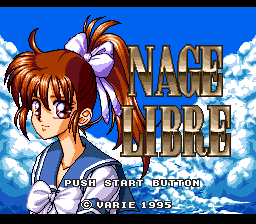
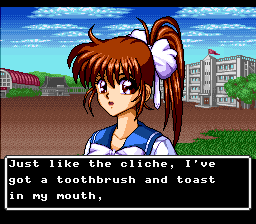
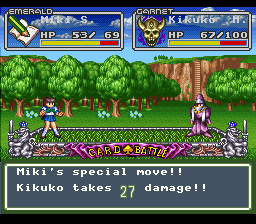

# Nage Libre: Seijaku no Suishin — English translation

**A complete English fan translation of *Nage Libre: Seijaku no Suishin* (Super Famicom, Varie, 1995).**

  

**Download:** get the patch from the [Releases page](https://github.com/ACR-GD/nage-libre/releases) (BPS recommended, IPS included) and apply it to the unheadered Japanese ROM, `Nage Libre - Seijaku no Suishin (Japan).sfc`: 1,572,864 bytes, CRC32 `A98F24E1`. The easiest way is [RomPatcher.js](https://www.marcrobledo.com/RomPatcher.js/). No ROMs are provided here.

**About this translation:** this is my first fan translation. It was AI-assisted (text decoding, insertion tools, first draft) and then proofread line by line by me, a human, and playtested. Mistakes may remain, so please [open an issue](https://github.com/ACR-GD/nage-libre/issues) with a screenshot if you find one. Full notes are in [`release/README.txt`](release/README.txt).

The rest of this page documents the translation tools, first in English, then in the original French.

---

# Nage Libre: translation tools (SNES)

Analysis and build tools for translating **Nage Libre: Seijaku no Suishin** (Super Famicom, Varie, 1995).

## Building the English ROM and patches

You need Python 3 with Pillow, and the Japanese ROM placed in the repo root as `Nage Libre - Seijaku no Suishin (Japan).sfc`.

```bash
python3 build_full_translation.py                 # -> nl-full-en.sfc (also writes docs/scene_overflow.csv)
python3 scripts/make_patches.py release "Nage Libre - Seijaku no Suishin (English v1.0)"
```

`build_full_translation.py` runs every step: scene dialogue (`build_scene_injection.py`), menus and battle text, names, clubs, the PAGER windows and the save screen. `docs/scene_overflow.csv` must contain only its header line after a build. Translations are edited in `docs/scenes/scene_XXXX.csv` (column `en`) and `docs/translations_review.csv`.

## Expected files

- `Nage Libre - Seijaku no Suishin (Japan).sfc`: LoROM, 1.5 MiB
- `*_1.mss` (optional): Mesen 2 savestate taken when the first text appears

## C# tools (`NageLibre.Tools`)

Requirement: .NET 8 (`brew install dotnet@8`).

```bash
cd NageLibre.Tools
export DOTNET_ROOT="/opt/homebrew/opt/dotnet@8/libexec"
export PATH="$DOTNET_ROOT:$PATH"

dotnet run -- export
dotnet run -- catalog-font      # glyph atlas + inventory
dotnet run -- map-glyphs        # byte -> hiragana/katakana table (glyph_unicode.csv)
dotnet run -- extract-all       # text + script + Japanese (〓 = unmapped kanji)
dotnet run -- decompress-scan   # scan for LZ01/10/11/12
dotnet run -- extract-mesen
dotnet run -- decompress 101000
dotnet run -- tile 50000 2
```

The New Game prologue uses a **16-bit** encoding in bank `$87`: see [`docs/prologue_text_engine.en.md`](docs/prologue_text_engine.en.md).

The CSV files are written to `docs/`:

| File | Contents |
|------|----------|
| `rom_info.csv` | Header, size, text encoding |
| `memory_map.csv` | ROM regions |
| `bank_entropy.csv` | Entropy per 32 KB bank |
| `compression_candidates.csv` | Possible LZ10/LZ01 blocks |
| `script_events_bank04.csv` | Scripts in bank `$84` @ `0x20000` |
| `text_8d_encoding.csv` | Strings with a `0x8D` prefix (custom encoding) |
| `font_metrics.csv` | Table `81 87 XX` @ `0xAFDD` |
| `palettes_from_savestate.csv` | CGRAM in BGR555 (from a savestate) |
| `mesen_savestate_fields.csv` | Mesen 2 MSS fields |
| `tcrf_notes.csv` | Easter eggs from [TCRF](https://tcrf.net/Nage_Libre) |

## Findings from screenshots (`Screenshots/`)

- The **16×16** font is made of **4 2bpp 8×8 tiles** (top-left corner, then +1, +16, +17 in VRAM).
- **こ** (ko), top-left quadrant: tile **$108**, VRAM **$5840.w** (= byte **$B080**), tileset **$5000.w**.
- The same glyph is in ROM @ **0x28540** (`$85:8540`), as 4 **contiguous** tiles in the file.
- Dialogue tilemap: **$7C00.w**, layer 3, **2bpp** format.
- See `docs/user_findings.csv` and the Mesen 2 captures in `Screenshots/`.

## Comparison with other Varie games (`varie-games/`)

ROMs compared: Super F-1 Hero, Putty Moon, Stardust Suplex, Undercover Cops.
Several titles share the same `0x84` pointer pattern; the こ signature only appears in Nage Libre.
Details: `docs/varie_games_comparison.csv`.

## Main findings (early research notes)

- **LoROM**, title `NAGE LIBRE`, little-endian.
- The text is **not Shift-JIS**: **1 byte = glyph index** (plus control codes `01`/`02`/`8D`/`20`/`FF`). See `docs/text_display_pipeline.md`.
- **Scripts / events** live in bank **`$84`**, with `lo, hi, 0x84` pointers (data from `0x20000`).
- **Compression**: many `0x10` / `0x01` headers (common Nintendo formats), to be confirmed with `decompress`.
- **Graphics**: 2bpp tiles in ROM and in VRAM (savestate); dialogue = tiles + CGRAM.
- **TCRF**: developer messages (birthdays 11/25), to extract once the encoding is reversed.

## SNES limits (reminder)

- 64 KB VRAM, 512 bytes CGRAM (256 colours × BGR555).
- 8×8 tiles in 2bpp (16 bytes) or 4bpp (32 bytes); 16-bit tilemap entries (VHPPTTTT TTTTTTTT).
- 128 KB WRAM; 24-bit addresses `$BB:OOOO`.

## Suggested next steps (from the early notes)

1. Find the **exact decompressor** (trace frequent JSLs from the code `@ $008xxx`).
2. Build the **glyph ↔ ID table** by matching savestates with the first dialogue line.
3. Extend the export of **decompressed strings** once the format is confirmed.

---

# Nage Libre — outils de traduction (SNES)

Projet d'analyse pour traduire **Nage Libre: Seijaku no Suishin** (スーパーファミコン, Varie, 1995).

## Fichiers attendus

- `Nage Libre - Seijaku no Suishin (Japan).sfc` — ROM LoROM, 1,5 Mio
- `*_1.mss` (optionnel) — savestate Mesen2 au moment du premier texte

## Outils C# (`NageLibre.Tools`)

Prérequis : .NET 8 (`brew install dotnet@8`).

```bash
cd NageLibre.Tools
export DOTNET_ROOT="/opt/homebrew/opt/dotnet@8/libexec"
export PATH="$DOTNET_ROOT:$PATH"

dotnet run -- export
dotnet run -- catalog-font      # atlas + inventaire glyphes
dotnet run -- map-glyphs        # table octet → hiragana/katakana (glyph_unicode.csv)
dotnet run -- extract-all       # texte + script + japonais (〓 si kanji non mappé)

Prologue New Game (encodage **16 bits**, bank `$87`) : voir `docs/prologue_text_engine.md` ([EN](docs/prologue_text_engine.en.md)).
dotnet run -- decompress-scan   # scan LZ01/10/11/12
dotnet run -- extract-mesen
dotnet run -- decompress 101000
dotnet run -- tile 50000 2
```

Les CSV sont écrits dans `docs/` :

| Fichier | Contenu |
|---------|---------|
| `rom_info.csv` | En-tête, taille, encodage texte |
| `memory_map.csv` | Régions ROM |
| `bank_entropy.csv` | Entropie par banque 32 Ko |
| `compression_candidates.csv` | Blocs LZ10/LZ01 possibles |
| `script_events_bank04.csv` | Scripts banque `$84` @ `0x20000` |
| `text_8d_encoding.csv` | Chaînes préfixe `0x8D` (encodage custom) |
| `font_metrics.csv` | Table `81 87 XX` @ `0xAFDD` |
| `palettes_from_savestate.csv` | CGRAM BGR555 (savestate) |
| `mesen_savestate_fields.csv` | Champs MSS Mesen2 |
| `tcrf_notes.csv` | Easter eggs [TCRF](https://tcrf.net/Nage_Libre) |

## Découvertes utilisateur (`Screenshots/`)

- Police **16×16** = **4 tuiles 2bpp 8×8** (coin HG +1, +16, +17 en VRAM).
- **こ** (ko), quadrant HG : tuile **$108**, VRAM **$5840.w** (= octet **$B080**), tileset **$5000.w**.
- Même glyphe en ROM @ **0x28540** (`$85:8540`) — 4 tuiles **contiguës** en fichier.
- Tilemap dialogue : **$7C00.w**, couche 3, format **2bpp**.
- Voir `docs/user_findings.csv` et captures Mesen2 dans `Screenshots/`.

## Comparaison Varie (`varie-games/`)

ROMs fournies : Super F-1 Hero, Putty Moon, Stardust Suplex, Undercover Cops.  
Même motif de pointeurs `0x84` sur plusieurs titres ; la signature du こ n’apparaît que dans Nage Libre.  
Détails : `docs/varie_games_comparison.csv`.

## Découvertes principales

- **LoROM**, titre `NAGE LIBRE`, little-endian.
- Le texte **n'est pas en Shift-JIS** : **1 octet = index glyphe** (+ contrôles `01`/`02`/`8D`/`20`/`FF`). Voir `docs/text_display_pipeline.md`.
- Les **scripts / événements** sont en banque **`$84`** avec pointeurs `lo, hi, 0x84` (données vers `0x20000+`).
- **Compression** : nombreux en-têtes `0x10` / `0x01` (formats Nintendo courants) — à valider par essai `decompress`.
- **Graphismes** : tuiles 2bpp présentes en ROM et en VRAM (savestate) ; dialogue = tuiles + CGRAM.
- **TCRF** : messages développeur (anniversaires 11/25) — texte à extraire après reverse de l'encodage.

## Limitations SNES (rappel)

- VRAM 64 Ko, CGRAM 512 octets (256 couleurs × BGR555).
- Tuiles 8×8 en 2bpp (16 o) ou 4bpp (32 o) ; tilemaps 16 bits (VHPPTTTT TTTTTTTT).
- WRAM 128 Ko ; banques 24 bits `$BB:OOOO`.

## Prochaines étapes suggérées

1. Identifier le **décompresseur exact** (tracer JSL fréquents depuis le code `@ $008xxx`).
2. Construire la **table glyphe ↔ ID** via corrélations savestate / première ligne de dialogue.
3. Étendre l'export des **chaînes décompressées** une fois le format confirmé.
