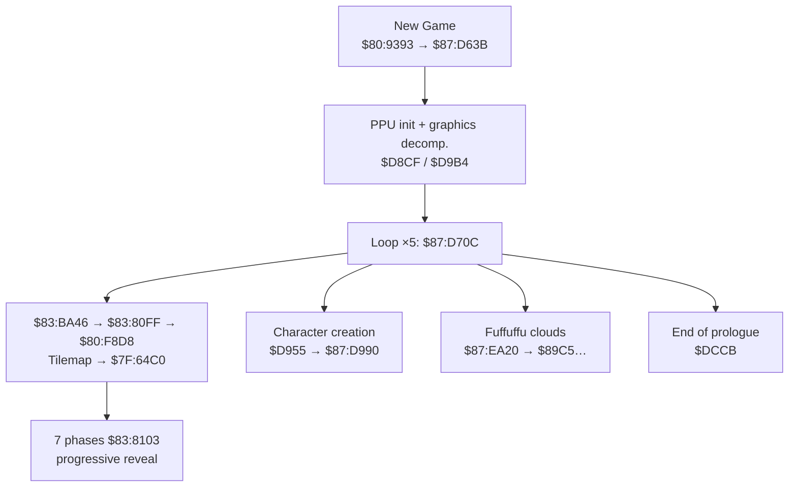

# Full prologue: map (New Game)

*English version of [`prologue_full_map.md`](prologue_full_map.md). Early research notes (May 2026); some hypotheses here were later corrected, see [`prologue_text_routines.en.md`](prologue_text_routines.en.md).*

> From static ROM analysis + PyGhidra (`$87:D63B`, `$83:BA46`, `$83:80FF`).
> **Screen** numbering = narrative order seen in game (not the strict CPU call order).

---

## Overview



| Pipeline | Engine | Destination |
|----------|--------|-------------|
| **Cutscenes** (stars, narration) | `$83:BA46` → `$80:F8D8` | WRAM `$7F:64C0` (BG3 tilemap) |
| **Typewriter ROM text** (clouds, UI) | `$80:F4A7` → `$80:F4AB` | VRAM `$7C00.w` |

---

## Screens (narrative order)

### Screen 1: starry background (PATCHED)

| | |
|---|---|
| **JP text** | 「遠くの世界で……声が響く……」 ("In a distant world… a voice echoes…") |
| **Pipeline** | Scene decompression → WRAM |
| **Buffer** | `$7F:65E2` = 30 words (`$0122`: 16 + 14 cells) |
| **Signature** | `075A` @ `$7F:6602` |
| **Patch** | `patch_prologue_en_test.py` |

---

### Screen 2: clouds / Fuffuffu

| | |
|---|---|
| **Line 1** | 「この世界を全て私の物に……」 ("This whole world shall be mine…") |
| **Line 2** | 「心に闇を抱く者達よ……集え」 ("Those with darkness in their hearts… gather") (split) |
| **Routine** | `$87:EA20` → `$87:EA45` / `$87:EA61` |
| **Engine** | `$80:F4A7` → `$80:F4AB` (sound + typewriter) |

| ROM address | Role | IDs (start) |
|-------------|------|-------------|
| **`$87:89C5`** | Full line 1 (12 words) | `0088 001C 0068 00FC 0092 00EC 00AE 002E 003A 0088 003E 009E` |
| **`$87:89DF`** | Line 2 fragment A (5 words) | `004C 008E 03FE 009E 0014` |
| **`$87:8A51`** | Fragment B (7 words) | `0144 0114 0092 …` |
| **`$87:8A61`** | Fragment C (7 words) | `008E 0068 0018 …` |
| **`$87:8A71`** | Fragment D (7 words) | `00D8 0118 0156 …` |

Confirmed reading of L1: **この世界を全て私の物に……**

---

### Screen 3: 西暦 / 地球 narration (WRAM only)

| | |
|---|---|
| **Assumed JP text** | 「西暦……地球には、争いという名の……」 ("In the year… on Earth, something called conflict…") |
| **Pipeline** | Same `$80:F8D8` decompression; the text is **not** in the ROM in plain form |
| **WRAM signatures** (scan of `$7F:64C0`) | |

| Signature @ `$64C0` | Contents |
|---------------------|----------|
| `02DE 01DA` | Start of line 1 (**西暦** in the prologue context, *not* `$87:896D`) |
| `005A 009C` | Start of line 2 (**地球**) |
| `00D0 0088` | Transition area / empty line |

> **Important correction:** `$87:896D` holds the **same bytes** as the UI string 「誕生日をおしえてね」, but it is **not** the 西暦 narration.
> IDs `02DE 01DA` = **誕+生** in the UI, and **西+暦** in the decompressed tilemap (same pair of IDs, different context).

#### "AM06:12"

**Not found** in ROM as an ASCII/Shift-JIS string. Hypotheses:

1. **Date/time display** in the WRAM tilemap (number tiles + separators), which may look like `AM06:12` if read with the wrong mapping.
2. **Mesen savestate needed**: pause on screen 3, dump `$7F:64C0` around the `02DE 01DA` signature, count the words up to `FFFF` or the end of the row.

Command: `python3 scripts/map_full_prologue.py`

---

### Screen 4: character creation / 「よーし」

| | |
|---|---|
| **Driver routine** | `$87:D955` then `$87:D990` |
| **Prompt** | **`$87:896D`** → 「**誕生日をおしえてね**」 ("Tell me your birthday", 9 words) |
| **Month/day UI** | `$87:8965` = 「月」, `$87:8969` = 「日」 (single tiles, via `$87:DA3B`) |
| **Confirmation** | **`$87:8981`** → 「**これで誕生日はいいかな　**」 ("Is this birthday OK?", 12 words) |

#### 「よーし」 ("Alright!"; ー = `~` / long-vowel tile)

**Not found** in ROM as the sequence `009E + 02F4/03C6 + 003A` (よ + ー + し).

Candidates:

| Source | Text | Note |
|--------|------|------|
| `$87:8981` | これで誕生日はいいかな | Confirmation, doesn't start with よーし |
| Easter egg (web) | みよーよぉ♥ | All birthdays set to 11/25, contains よー |
| **Scene WRAM** | ? | Likely if よーし is said on screen, **to confirm with a savestate** |

UI long-vowel tiles: **`0x03C6`** (ー in menus), **`0x02F4`**, katakana **`0x00FE`** (一 used as a visual long-vowel mark).

---

## Driver `$87:D63B`: CPU sequence

| Step | Routine | Role |
|------|---------|------|
| 1 | `$87:DA0E` | Loads the config `$17D4+` from `$87:DA31` |
| 2 | `$87:D8CF` | Decompresses assets (`$80:FA63`, ×3) |
| 3 | **`$87:D955`** | `$87:DA3B` (月/日) + `$87:DA8C` + **`$87:D990`** (896D) |
| 4 | `$87:D9B4` | Palette/sprite init |
| 5 | **Loop ×5 `$87:D70C`** | `$87:D9D7` gfx + `$87:DA3B/DA8C` + **`JSL $83:BA46`** |
| 6 | `$87:DCCB` | Transition to the game |

Each `$87:D70C` calls **`$83:BA46`** → scene table `$83:BAD9` indexed by **`$17D6`** → ends at **`$83:80FF` / `$80:F8D8`**.

Animation parameters per loop index: **`$87:D4EA`** = `$01B0`…`$01B4`.

---

## Disproved assumptions / traps

| Address | Assumed | Reality |
|---------|---------|---------|
| `$87:892F` | Prologue | **「お金がたりません‼」** ("Not enough money!!", shop UI) |
| `$87:896D` | 西暦… | **「誕生日をおしえてね」** (character creation) |
| `$87:8789` | Prologue | **「 西暦」+ 誕生石** (birthstone UI) |

---

## Scripts

```bash
python3 scripts/map_full_prologue.py      # F4A7 loads + signatures
python3 scripts/decode_bank87_string.py 89C5 89DF 8A51 896D 8981
python3 scripts/pyghidra_prologue_disasm.py
```

## Next steps (savestate)

1. **Screen 3**: break on `$83:80FF` or `$83:BA46`, dump `$7F:64C0`, extract N words @ `02DE 01DA` and @ `005A 009C`.
2. **Screen 4**: break on `$87:D990` / `$80:F4AB`, read `$09-$0B`; look for よーし in WRAM if it isn't in the ROM.

---

*2026-05-19. ROM: `Nage Libre - Seijaku no Suishin (Japan).sfc`*
