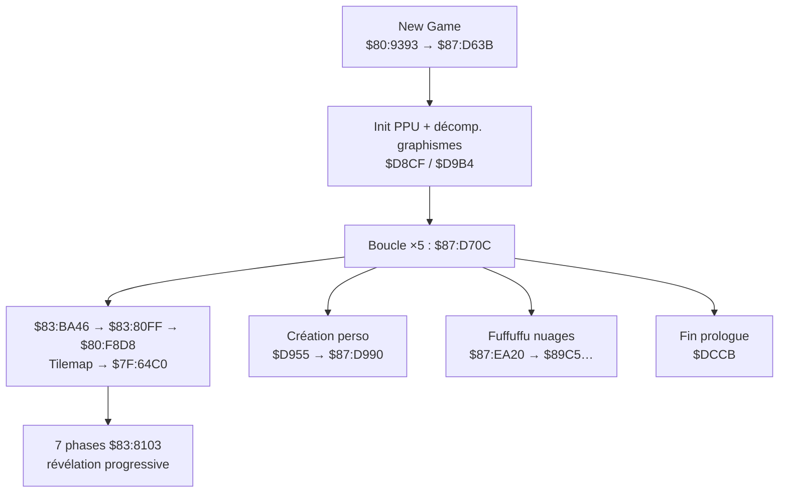

# Prologue complet — cartographie (New Game)

> Suite à analyse statique ROM + PyGhidra (`$87:D63B`, `$83:BA46`, `$83:80FF`).  
> Numérotation **écran** = ordre narratif observé en jeu (pas l’ordre d’appel CPU strict).

---

## Vue d’ensemble



| Pipeline | Moteur | Destination |
|----------|--------|-------------|
| **Scènes cinématiques** (étoiles, narration) | `$83:BA46` → `$80:F8D8` | WRAM `$7F:64C0` (tilemap BG3) |
| **Texte ROM typewriter** (nuages, UI) | `$80:F4A7` → `$80:F4AB` | VRAM `$7C00.w` |

---

## Écrans (ordre narratif)

### Écran 1 — Fond étoilé (PATCHÉ)

| | |
|---|---|
| **Texte JP** | 「遠くの世界で……声が響く……」 |
| **Pipeline** | Décompression scène → WRAM |
| **Buffer** | `$7F:65E2` = 30 mots (`$0122` : 16 + 14 cellules) |
| **Signature** | `075A` @ `$7F:6602` |
| **Patch** | `patch_prologue_en_test.py` |

---

### Écran 2 — Nuages / Fuffuffu

| | |
|---|---|
| **Ligne 1** | 「この世界を全て私の物に……」 |
| **Ligne 2** | 「心に闇を抱く者達よ……集え」 ( découpée ) |
| **Routine** | `$87:EA20` → `$87:EA45` / `$87:EA61` |
| **Moteur** | `$80:F4A7` → `$80:F4AB` (son + typewriter) |

| Adresse ROM | Rôle | IDs (début) |
|-------------|------|-------------|
| **`$87:89C5`** | Ligne 1 complète (12 mots) | `0088 001C 0068 00FC 0092 00EC 00AE 002E 003A 0088 003E 009E` |
| **`$87:89DF`** | Ligne 2 fragment A (5 mots) | `004C 008E 03FE 009E 0014` |
| **`$87:8A51`** | Fragment B (7 mots) | `0144 0114 0092 …` |
| **`$87:8A61`** | Fragment C (7 mots) | `008E 0068 0018 …` |
| **`$87:8A71`** | Fragment D (7 mots) | `00D8 0118 0156 …` |

Lecture confirmée L1 : **この世界を全て私の物に……**

---

### Écran 3 — Narration 西暦 / 地球 (WRAM uniquement)

| | |
|---|---|
| **Texte JP supposé** | 「西暦……地球には、争いという名の……」 |
| **Pipeline** | Même décompression `$80:F8D8` ; texte **absent** en clair en ROM |
| **Signatures WRAM** (scan `$7F:64C0`) | |

| Signature @ `$64C0` | Contenu |
|---------------------|---------|
| `02DE 01DA` | Début ligne 1 (**西暦** en contexte prologue — *pas* `$87:896D`) |
| `005A 009C` | Début ligne 2 (**地球**) |
| `00D0 0088` | Zone transition / ligne vide |

> **Correction importante :** `$87:896D` contient les **mêmes octets** que l’UI 「誕生日をおしえてね」, mais ce n’est **pas** la narration 西暦.  
> Les IDs `02DE 01DA` = **誕+生** dans l’UI, **西+暦** dans le tilemap décompressé (même paire d’IDs, contexte différent).

#### « AM06:12 »

**Non trouvé** en ROM comme chaîne ASCII/Shift-JIS. Hypothèses :

1. **Affichage date/heure** dans le tilemap WRAM (tuiles numériques + séparateurs) — peut ressembler à `AM06:12` si lu avec un mauvais mapping.
2. **Savestate Mesen requis** : pause sur l’écran 3, dump `$7F:64C0` autour de la signature `02DE 01DA`, compter les mots jusqu’à `FFFF` ou fin de rangée.

Commande : `python3 scripts/map_full_prologue.py`

---

### Écran 4 — Création personnage / 「よーし」

| | |
|---|---|
| **Routine driver** | `$87:D955` puis `$87:D990` |
| **Prompt** | **`$87:896D`** → 「**誕生日をおしえてね**」 (9 mots) |
| **UI mois/jour** | `$87:8965` = 「月」, `$87:8969` = 「日」 (tuiles seules, via `$87:DA3B`) |
| **Confirmation** | **`$87:8981`** → 「**これで誕生日はいいかな　**」 (12 mots) |

#### 「よーし」 (ー = `~` / tuile prolongation)

**Pas trouvé** en ROM comme séquence `009E + 02F4/03C6 + 003A` (よ + ー + し).

Candidats :

| Source | Texte | Note |
|--------|-------|------|
| `$87:8981` | これで誕生日はいいかな | Confirmation, ne commence pas par よーし |
| Easter egg (web) | みよーよぉ♥ | Tous anniversaires 11/25 — contient よー |
| **WRAM scène** | ? | Probable si よーし est dit à l’écran — **à confirmer savestate** |

Tuiles prolongation UI : **`0x03C6`** (ー dans menus), **`0x02F4`**, katakana **`0x00FE`** (一 utilisé comme prolongation visuelle).

---

## Driver `$87:D63B` — séquence CPU

| Étape | Routine | Rôle |
|-------|---------|------|
| 1 | `$87:DA0E` | Charge config `$17D4+` depuis `$87:DA31` |
| 2 | `$87:D8CF` | Décompresse assets (`$80:FA63`, ×3) |
| 3 | **`$87:D955`** | `$87:DA3B` (月/日) + `$87:DA8C` + **`$87:D990`** (896D) |
| 4 | `$87:D9B4` | Init palettes/sprites |
| 5 | **Boucle ×5 `$87:D70C`** | `$87:D9D7` gfx + `$87:DA3B/DA8C` + **`JSL $83:BA46`** |
| 6 | `$87:DCCB` | Transition vers le jeu |

Chaque `$87:D70C` appelle **`$83:BA46`** → table scènes `$83:BAD9` indexée par **`$17D6`** → finit par **`$83:80FF` / `$80:F8D8`**.

Paramètres animation par index boucle : **`$87:D4EA`** = `$01B0`…`$01B4`.

---

## Infirmations / pièges

| Adresse | Supposé | Réalité |
|---------|---------|---------|
| `$87:892F` | Prologue | **「お金がたりません‼」** (UI shop) |
| `$87:896D` | 西暦… | **「誕生日をおしえてね」** (création perso) |
| `$87:8789` | Prologue | **「 西暦」+ 誕生石** (UI birthstone) |

---

## Scripts

```bash
python3 scripts/map_full_prologue.py      # F4A7 loads + signatures
python3 scripts/decode_bank87_string.py 89C5 89DF 8A51 896D 8981
python3 scripts/pyghidra_prologue_disasm.py
```

## Prochaines étapes (savestate)

1. **Écran 3** : break `$83:80FF` ou `$83:BA46`, dump `$7F:64C0` — extraire N mots @ `02DE 01DA` et @ `005A 009C`.
2. **Écran 4** : break `$87:D990` / `$80:F4AB`, lire `$09-$0B` ; chercher よーし en WRAM si absent de la ROM.

---

*2026-05-19 — ROM : `Nage Libre - Seijaku no Suishin (Japan).sfc`*
