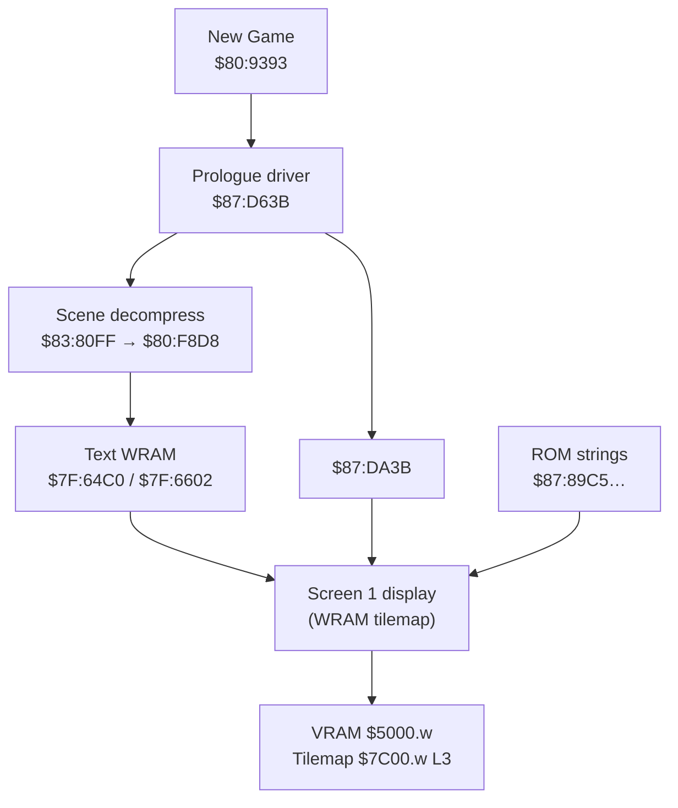

# Prologue (New Game) — text encoding and CPU routines

Reference document for **Nage Libre: Seijaku no Suishin** (SNES, LoROM).  
Analysis: original ROM, Python scripts in this repo, **PyGhidra** (65816).

> **Français:** [prologue_text_engine.md](prologue_text_engine.md)

---

## Summary (confirmed / refuted)

| SNES address | Assumed text (user) | Verdict | Actual text / role |
|--------------|---------------------|---------|-------------------|
| **`$87:892F`** | 遠くの世界で……声が響く…… | **Refuted** | UI string **「お金がたりません‼」** (table `$87:8697`, entry #39). Referenced in code (`$87:D3C7`) but **not** the prologue. |
| **`$87:896D`** | 西暦……地球には、争いという名の…… | **Partial** | Called by the prologue (`$87:D990` → `$80:F4A7`). ROM content: **9 words** starting with **西暦** (`02DE 01DA`), not the full screen 1 sentence. |
| **`$87:89C5`** | この世界は、我が物…… | **Confirmed** (screen 2) | **「この世界を全て私の物に……」** (12 words). Loaded at **`$87:EA36`**. |
| **`$87:89DF`** | 心に闇を抱く者達よ……集え | **Confirmed** (screen 2, L2 start) | Starts with **「心に … 闇」**; continues in **`$87:8A51`**, **`$87:8A61`**, **`$87:8A71`**. Loaded at **`$87:EA46`**. |

**Key point:** the opening line **「遠くの世界で……声が響く……」** (screen 1, starfield) is **not** stored in plain ROM at `$87:892F`. It appears in **WRAM** after scene decompression, with ID **`0x075A` = 遠** at **`$7F:6602`** (see § Screen 1).

---

## Two text encodings in this game

| Context | Format | Bank / region |
|---------|--------|---------------|
| In-game dialogue (bank `$84`) | **1 byte** = glyph index + `01`/`FF` controls | `$84:xxxx` / `$87:22000+` |
| **Prologue, menus, battle** | **16-bit LE** = font tile ID + **`FFFF`** terminator | Mostly **`$87:8800–$8B00`**, WRAM `$7F:64xx` |

The New Game prologue uses **only the 16-bit format** (not Shift-JIS, not the 1-byte bank `$84` dialogue encoding).

---

## 16-bit format (Bank $87)

```
[word0 LE][word1 LE]…[FFFF]
```

- Each **word** = 16×16 glyph ID (font in banks `$85`/`$86`).
- **`0xFFFF`** = end of string.
- Common codes:
  - **`0x02AA` / `0x02FE`** — ellipsis (……)
  - **`0x03FE`** — space
  - **`0x02E0`** — **‼**
  - **`0x0346`** — full-width space (　)

### Font in ROM (glyph → bitmap)

```text
rom_offset = f(char_id)
a = (char_id * 32 + 0x8000) & 0xFFFF
if a >= 0x8000 → bank $85, offset a - 0x8000
else             → bank $86, offset a
glyph size     = 64 bytes (4× 2bpp 8×8 tiles)
```

Implementation: `char_id_to_rom()` in `build_patched_rom.py` / `patch_prologue_v3.py`.

Partial mapping tables: `docs/glyph_mapping.csv`, `docs/glyph_mapping_wip_fixed.csv`, `patch_rom.py` (dict `C`).

---

## Two prologue screens, two pipelines



### Screen 1 — starfield / scrolling text

1. **`$80:9393`** — `JSL $87:D63B` (prologue entry after New Game).
2. Scene decompression: **`$83:80FF`** → **`JSL $80:F8D8`** (wrapper → `$80:F8DC`).
3. **16-bit IDs** are copied to **WRAM**:
   - **`$7F:6602`** — prologue signature: first word **`0x075A` (遠)** for the opening line.
   - **`$7F:64C0`** — larger buffer; signatures used by translation hooks:
     - `02DE 01DA` — **西暦** (start of long line 1)
     - `005A 009C` — **地球** (start of line 2)
     - `0088 001C` — **この** (link to screen 2)
     - `0144 0114` — **心に** (link to screen 2 line 2)

4. **Expected IDs** for 「遠くの世界で……声が響く……」 (14 words, `patch_rom.py`):

```text
075A 002A 0068 033A 033C 005A 02AA 02AA 070E 0024 04BE 002A 02AA 02AA
```

This sequence **does not exist** as a contiguous ROM block (confirmed by scan): it is **produced at runtime** by the scene decompressor.

### Screen 2 — clouds / Fuffuffu

1. Same driver **`$87:D63B`**, then **`JSR $87:DA0E`** (copies a table of 5 pointers from **`$87:DA31`** to game WRAM **`$17D4–$17DD`**).
2. **`$87:DA3B`**:
   - Sets **`$1141 = $0C0F`** (display mode),
   - Stores a 24-bit pointer in **`$09–$0B`** (bank `$87`, offset `$89xx`),
   - **`JSL $80:F4A7`** → **`JSR $80:F4AB`** (text engine).

Example at **`$87:DA3B`** (PyGhidra / ROM bytes):

```text
A9 65  85 09    ; offset low  → $xx65  (first call: $8965)
A9 89  85 0A
A9 87  85 0B    ; bank $87
JSL $80:F4A7
```

**Confirmed** loads (pattern `LDA #imm; STA $09/$0A/$0B; JSL $80:F4A7`):

| Code site | Pointer | ROM string |
|-----------|---------|------------|
| `$87:D990` | **`$87:896D`** | 9 words, starts with 西暦 |
| `$87:EA36` | **`$87:89C5`** | Screen 2 line 1 |
| `$87:EA46` | **`$87:89DF`** | Screen 2 line 2 (part A) |
| (+ similar calls for **`$87:8A51`**, **`$87:8A61`**, **`$87:8A71`**) | | line 2 continuation |

---

## Documented ROM strings (bytes)

### `$87:89C5` — Screen 2, line 1 (12 words)

```text
ROM 0x0389C5:
88 00 1C 00 68 00 FC 00 92 00 EC 00 AE 00 2E 00 3A 00 88 00 3E 00 9E 00 FF FF
```

| IDs | Reading |
|-----|---------|
| `0088 001C 0068 00FC 0092 00EC 00AE 002E 003A 0088 003E 009E` | **この世界を全て私の物に……** |

### `$87:89DF` + `$87:8A51` + `$87:8A61` + `$87:8A71` — Screen 2, line 2

Concatenation (each block until `FFFF`):

```text
004C 008E 03FE 009E 0014 | 0144 0114 0092 … | 008E 0068 0018 … | 00D8 0118 0156 00B6 00B2 …
```

Partial reading (prologue mapping): **心に … 闇** + **者達よ** + … + **集え** (remaining kanji to refine via `glyph_mapping_wip_fixed.csv`).

### `$87:896D` — Screen 1 fragment (9 words)

```text
02DE 01DA 02C8 00AE 0020 003A 001C 0058 0066 FF FF
```

Starts with **西暦**; continuation ≠ 「地球には、争いという名の……」 (full sentence elsewhere: post-decompression WRAM or another pointer).

### `$87:892F` — **Not prologue**

```text
0020 02FE 0024 004A 00A4 0088 0042 00B0 02E0 03FE 03FE 03FE FF FF
→ お金がたりません‼   (shop message)
```

---

## CPU routines (PyGhidra, 65816)

| Address | Role |
|---------|------|
| **`$80:938C`** | New Game sequence: `JSL $83:B9C0`, `JSR $809B20`, **`JSL $87:D63B`** |
| **`$87:D63B`** | Prologue driver: PPU init (`$2100`, `$1143`…), **`JSR $87:DA0E`**, calls `$80:8684`, `$80:869C`, `$82:BBC5`… |
| **`$87:DA0E`** | Copies 5 words from **`$87:DA31`** → **`$17D4`** (internal pointers) |
| **`$87:DA3B`** | Sets up **`$09–$0B`**, **`JSL $80:F4A7`** (displays ROM string) |
| **`$80:F4A7`** | `JSR $80:F4AB`; **`RTL`** |
| **`$80:F4AB`** | Loop: read words via **`LDA [$09]`**, **`CMP #$FFFF`**, load glyphs (`JSL $8088E4`), write tilemap; **`$09`** += 2 |
| **`$83:80FF`** | **`JSL $80:F8D8`** — scene decompression (text → WRAM) |
| **`$80:F8D8`** | `JSR $80:F8DC`; **`RTL`** |

Reproducible script:

```bash
export GHIDRA_INSTALL_DIR="/opt/homebrew/Cellar/ghidra/12.1.1/libexec"
python3 scripts/pyghidra_prologue_disasm.py
```

String decoder:

```bash
python3 scripts/decode_bank87_string.py 89C5 89DF 8A51 8A61 8A71 896D 892F
```

---

## Mesen — what to inspect

| Tool | Address | Use |
|------|---------|-----|
| **Memory Editor** | ROM **`0x389C5`** | Verify screen 2 prologue 16-bit words |
| **Debugger** | Break **`$87:EA36`** or **`$80:F4AB`** | Inspect **`$09–$0B`** = string pointer |
| **Layer Viewer** | BG3, tilemap **`$7C00.w`**, tileset **`$5000.w`** | Final render (same as `$84` dialogue) |
| **Savestate `.mss`** | WRAM **`$7F:6602`**, **`$7F:64C0`** | Screen 1 text **after** decompression (not visible in static ROM) |

Workflow:

1. New Game → pause on the **first** line (stars) → search WRAM for **`5A 07`** (LE **`075A`**) around **`6602`**.
2. Pause on **cloud** screen → break on **`F4AB`** → read **`$09-$0B`**: should be **`87:89C5`** or **`87:89DF`**.

---

## Translation / patching

Existing work in the repo:

| File | Approach |
|------|----------|
| `patch_rom.py` | Hook **`$83:80FF`**, patch WRAM **`$7F:6602`** (same length, 16-bit IDs) |
| `patch_prologue_v3.py` | Hook scan **`$7F:64C0`** + direct patch **`$87:89C5`…** for screen 2 |
| `build_patched_rom.py` | Full translation of table **`$87:8697`** (UI + messages) |

To reinject prologue text:

1. Encode as a **list of 16-bit IDs** (same **word count** if possible).
2. Screen 2: patch **`0x0389C5`**, **`0x0389DF`**, **`0x038A51`**… in little-endian.
3. Screen 1: hook **`$83:80FF`** or modify the **compressed scene** (harder).

---

## Related files

| File | Contents |
|------|----------|
| `docs/prologue_text_engine.md` | French version of this document |
| `docs/prologue_text_engine.en.md` | This document (English) |
| `scripts/decode_bank87_string.py` | CLI decoder |
| `scripts/pyghidra_prologue_disasm.py` | PyGhidra disassembler |
| `docs/extracted_scripts.csv` | Table `$87:8697` (UI, not full prologue) |
| `docs/glyph_mapping.csv` | IDs ↔ characters (partial) |
| `patch_rom.py` | Mapping `C` + opening line IDs |
| `dump_ptrs.py` | String addresses `$87:88xx–8Axx` |

---

## Confirmed architecture (static analysis, 2026-05-19)

### `$7F:64C0` = full decompressed BG3 tilemap (not an isolated text buffer)

Before **`JSL $80:F8D8`** at **`$83:80FF`**, the game sets **`$06/$07/$08 = $7F:64C0`**.  
`$80:F8DC` decompresses the **entire scene** (text box border, UI tiles, **and** text glyphs) into **`$7F:64C0+`**, then copies to VRAM **`$7C00.w`**.

| Offset from `$64C0` | WRAM addr | Role |
|---------------------|-----------|------|
| `$0122` | `$7F:65E2` | Row 1 visible (16 entries) |
| `$0142` | `$7F:6602` | **Screen 1 text** — signature `075A` (遠), **14 entries** |
| `$01A2` | `$7F:6662` | Row 2 |
| `$0222` | `$7F:66E2` | Row 3 — **screen 2 text preloaded** in same buffer |
| `$02A2`+ | … | More rows / bottom border |

**Previous patch mistake:** bulk-writing `JP_SPACE` (`03FE`) across `$0122`–`$0322` **erased border tiles** and let phase handlers reveal JP text from later rows.

### Safe patch rule (screen 1)

1. Hook **`$83:80FF`** → call `$80:F8D8`, then replace **only 14 words** at **`$7F:6602`**.
2. **Never** bulk-clear `$7F:64C0`.
3. Do not confuse offset `$0122` (tilemap row) with `$6602` (14-glyph text stream).

### After decompression: 7 animation phases (`$83:8103`)

Counter **`$06`** is compared to **`$0001`…`$0007`**; each phase calls a handler (`$8383EE`, `$83849A`, …) that reveals part of the decompressed tilemap.

### Typewriter sound

- **Screen 2:** `$80:F4AB` → `JSL $8088E4` (sound/init) → loop `JSR $80:F433` per glyph until `FFFF`.
- **Screen 1:** text is preloaded in the tilemap; phases reveal rows progressively — corrupted rows cause JP screen-2 text and sounds shortly after broken patches.

---

## Conclusion

- **Prologue encoding**: **16-bit tile IDs**, **`FFFF`** terminator, font in **`$85/$86`**.
- **`$87:89C5`** and **`$87:89DF`** (+ **`8A51/61/71`**) : **confirmed** for **screen 2**.
- **`$87:896D`**: **used** by prologue code, but only a **fragment** starting with **西暦**, not the full screen 1 sentence.
- **`$87:892F`**: **refuted** — message **「お金がたりません」**, not 「遠くの世界で」.
- **「遠くの世界で……」**: in **WRAM** after **`$80:F8D8`**, signature **`075A`** @ **`$7F:6602`**.

*Generated 2026-05-19 — ROM: `Nage Libre - Seijaku no Suishin (Japan).sfc`, LoROM 1.5 MB.*
