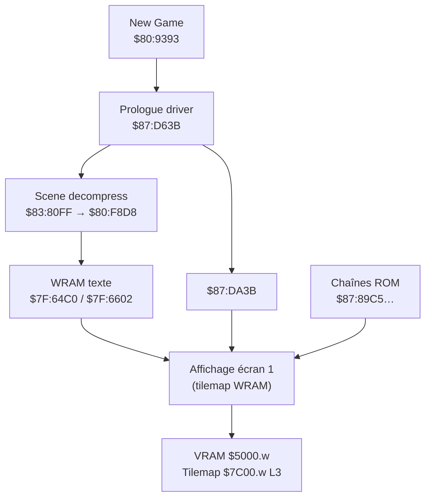

# Prologue (New Game) — encodage texte et routines CPU

Document de référence pour **Nage Libre: Seijaku no Suishin** (SNES, LoROM).  
Analyse : ROM d’origine, scripts Python du dépôt, **PyGhidra** (65816).

> **English:** [prologue_text_engine.en.md](prologue_text_engine.en.md)

---

## Résumé (confirmation / infirmation)

| Adresse SNES | Texte supposé (utilisateur) | Verdict | Texte réel / rôle |
|--------------|----------------------------|---------|-------------------|
| **`$87:892F`** | 遠くの世界で……声が響く…… | **Infirmé** | Chaîne UI **「お金がたりません‼」** (table `$87:8697`, entrée #39). Référencée en code (`$87:D3C7`) mais **pas** le prologue. |
| **`$87:896D`** | 西暦……地球には、争いという名の…… | **Partiel** | Appelée par le prologue (`$87:D990` → `$80:F4A7`). Contenu ROM : **9 mots** commençant par **西暦** (`02DE 01DA`), pas la phrase complète de l’écran 1. |
| **`$87:89C5`** | この世界は、我が物…… | **Confirmé** (écran 2) | **「この世界を全て私の物に……」** (12 mots). Chargée à **`$87:EA36`**. |
| **`$87:89DF`** | 心に闇を抱く者達よ……集え | **Confirmé** (écran 2, début L2) | Début **「心に … 闇」** ; suite dans **`$87:8A51`**, **`$87:8A61`**, **`$87:8A71`**. Chargée à **`$87:EA46`**. |

**Point clé :** l’ouverture **「遠くの世界で……声が響く……」** (écran 1, fond étoilé) **n’est pas** stockée en clair à `$87:892F`. Elle apparaît en **WRAM** après décompression de scène, avec l’ID **`0x075A` = 遠** à **`$7F:6602`** (voir § Écran 1).

---

## Deux encodages texte dans ce jeu

| Contexte | Format | Banque / zone |
|----------|--------|----------------|
| Dialogue in-game (banque `$84`) | **1 octet** = index glyphe + contrôles `01`/`FF` | `$84:xxxx` / `$87:22000+` |
| **Prologue, menus, combat** | **16 bits LE** = ID tuile police + **`FFFF`** fin | Surtout **`$87:8800–$8B00`**, WRAM `$7F:64xx` |

Le prologue New Game utilise **exclusivement le format 16 bits** (pas Shift-JIS, pas l’encodage 1 octet du dialogue `$84`).

---

## Format 16 bits (Bank $87)

```
[word0 LE][word1 LE]…[FFFF]
```

- Chaque **word** = ID de glyphe 16×16 (police `$85`/`$86`).
- **`0xFFFF`** = fin de chaîne.
- Codes fréquents :
  - **`0x02AA` / `0x02FE`** — ellipse (……)
  - **`0x03FE`** — espace
  - **`0x02E0`** — **‼**
  - **`0x0346`** — espace pleine largeur (　)

### Police en ROM (glyph → bitmap)

```text
rom_offset = f(char_id)
a = (char_id * 32 + 0x8000) & 0xFFFF
si a >= 0x8000 → bank $85, offset a - 0x8000
sinon            → bank $86, offset a
taille glyphe   = 64 octets (4 tuiles 2bpp 8×8)
```

Implémentation : `char_id_to_rom()` dans `build_patched_rom.py` / `patch_prologue_v3.py`.

Table partielle : `docs/glyph_mapping.csv`, `docs/glyph_mapping_wip_fixed.csv`, `patch_rom.py` (dict `C`).

---

## Deux écrans du prologue, deux pipelines



### Écran 1 — fond étoilé / texte défilant

1. **`$80:9393`** — `JSL $87:D63B` (entrée prologue après New Game).
2. Décompression de scène : **`$83:80FF`** → **`JSL $80:F8D8`** (wrapper → `$80:F8DC`).
3. Les **IDs 16 bits** du texte sont copiés en **WRAM** :
   - **`$7F:6602`** — signature prologue : premier mot **`0x075A` (遠)** pour la ligne d’ouverture.
   - **`$7F:64C0`** — buffer plus large ; signatures utilisées par les hooks de traduction :
     - `02DE 01DA` — **西暦** (début ligne 1 longue)
     - `005A 009C` — **地球** (début ligne 2)
     - `0088 001C` — **この** ( lien écran 2 )
     - `0144 0114` — **心に** ( lien ligne 2 écran 2 )

4. **IDs attendus** pour 「遠くの世界で……声が響く……」 (14 mots, `patch_rom.py`) :

```text
075A 002A 0068 033A 033C 005A 02AA 02AA 070E 0024 04BE 002A 02AA 02AA
```

Cette séquence **n’existe pas** en ROM en bloc contigu (confirmé par scan) : elle est **produite à l’exécution** par le décompresseur de scène.

### Écran 2 — nuages / Fuffuffu

1. Même driver **`$87:D63B`**, puis **`JSR $87:DA0E`** (copie une table de 5 pointeurs depuis **`$87:DA31`** vers **`$17D4–$17DD`** en WRAM jeu).
2. **`$87:DA3B`** :
   - Met **`$1141 = $0C0F`** (mode affichage),
   - Place un pointeur 24 bits dans **`$09–$0B`** (bank `$87`, offset `$89xx`),
   - **`JSL $80:F4A7`** → **`JSR $80:F4AB`** (moteur texte).

Exemple **`$87:DA3B`** (extrait PyGhidra / octets ROM) :

```text
A9 65  85 09    ; offset low  → $xx65  (premier appel: $8965)
A9 89  85 0A
A9 87  85 0B    ; bank $87
JSL $80:F4A7
```

Chargements **confirmés** (pattern `LDA #imm; STA $09/$0A/$0B; JSL $80:F4A7`) :

| Site code | Pointeur | Chaîne ROM |
|-----------|----------|------------|
| `$87:D990` | **`$87:896D`** | 9 mots, commence par 西暦 |
| `$87:EA36` | **`$87:89C5`** | Écran 2 ligne 1 |
| `$87:EA46` | **`$87:89DF`** | Écran 2 ligne 2 (partie A) |
| (+ appels similaires pour **`$87:8A51`**, **`$87:8A61`**, **`$87:8A71`**) | | suite ligne 2 |

---

## Chaînes ROM documentées (octets)

### `$87:89C5` — Écran 2, ligne 1 (12 mots)

```text
ROM 0x0389C5:
88 00 1C 00 68 00 FC 00 92 00 EC 00 AE 00 2E 00 3A 00 88 00 3E 00 9E 00 FF FF
```

| IDs | Lecture |
|-----|---------|
| `0088 001C 0068 00FC 0092 00EC 00AE 002E 003A 0088 003E 009E` | **この世界を全て私の物に……** |

### `$87:89DF` + `$87:8A51` + `$87:8A61` + `$87:8A71` — Écran 2, ligne 2

Concaténation (jusqu’à `FFFF` sur chaque bloc) :

```text
004C 008E 03FE 009E 0014 | 0144 0114 0092 … | 008E 0068 0018 … | 00D8 0118 0156 00B6 00B2 …
```

Lecture partielle (mapping prologue) : **心に … 闇** + **者達よ** + … + **集え** (kanji restants à affiner via `glyph_mapping_wip_fixed.csv`).

### `$87:896D` — Fragment écran 1 (9 mots)

```text
02DE 01DA 02C8 00AE 0020 003A 001C 0058 0066 FF FF
```

Début **西暦** ; suite ≠ 「地球には、争いという名の……」 (phrase complète ailleurs : WRAM post-décompression ou autre pointeur).

### `$87:892F` — **Pas prologue**

```text
0020 02FE 0024 004A 00A4 0088 0042 00B0 02E0 03FE 03FE 03FE FF FF
→ お金がたりません‼   (message boutique)
```

---

## Routines CPU (PyGhidra, 65816)

| Adresse | Rôle |
|---------|------|
| **`$80:938C`** | Séquence New Game : `JSL $83:B9C0`, `JSR $809B20`, **`JSL $87:D63B`** |
| **`$87:D63B`** | Driver prologue : init PPU (`$2100`, `$1143`…), **`JSR $87:DA0E`**, appels `$80:8684`, `$80:869C`, `$82:BBC5`… |
| **`$87:DA0E`** | Copie 5 mots depuis **`$87:DA31`** → **`$17D4`** (pointeurs internes) |
| **`$87:DA3B`** | Configure **`$09–$0B`**, **`JSL $80:F4A7`** (affiche chaîne ROM) |
| **`$80:F4A7`** | `JSR $80:F4AB`; **`RTL`** |
| **`$80:F4AB`** | Boucle : lit mots via **`LDA [$09]`**, **`CMP #$FFFF`**, charge glyphes (`JSL $8088E4`), écrit tilemap ; **`$09`** avance de 2 |
| **`$83:80FF`** | **`JSL $80:F8D8`** — décompression de scène (texte → WRAM) |
| **`$80:F8D8`** | `JSR $80:F8DC`; **`RTL`** |

Script reproductible :

```bash
export GHIDRA_INSTALL_DIR="/opt/homebrew/Cellar/ghidra/12.1.1/libexec"
python3 scripts/pyghidra_prologue_disasm.py
```

Décodage chaîne :

```bash
python3 scripts/decode_bank87_string.py 89C5 89DF 8A51 8A61 8A71 896D 892F
```

---

## Mesen — que regarder

| Outil | Adresse | Usage |
|-------|---------|--------|
| **Memory Editor** | ROM **`0x389C5`** | Vérifier les mots 16 bits du prologue écran 2 |
| **Debugger** | Break **`$87:EA36`** ou **`$80:F4AB`** | Voir **`$09–$0B`** = pointeur chaîne |
| **Layer Viewer** | BG3, tilemap **`$7C00.w`**, tileset **`$5000.w`** | Rendu final (identique au dialogue `$84`) |
| **Savestate `.mss`** | WRAM **`$7F:6602`**, **`$7F:64C0`** | Texte écran 1 **après** décompression (pas visible en ROM statique) |

Workflow :

1. New Game → pause sur la **première** ligne (étoiles) → chercher **`5A 07`** (LE **`075A`**) en WRAM vers **`6602`**.
2. Pause écran **nuages** → break sur **`F4AB`** → lire **`$09-$0B`** : doit valoir **`87:89C5`** ou **`87:89DF`**.

---

## Traduction / patch

Travaux existants dans le dépôt :

| Fichier | Approche |
|---------|----------|
| `patch_rom.py` | Hook **`$83:80FF`**, patch WRAM **`$7F:6602`** (même longueur, IDs 16 bits) |
| `patch_prologue_v3.py` | Hook scan **`$7F:64C0`** + patch direct **`$87:89C5`…** pour écran 2 |
| `build_patched_rom.py` | Traduction globale table **`$87:8697`** (UI + messages) |

Pour réinjecter du texte prologue :

1. Encoder en **liste d’IDs 16 bits** (même **nombre de mots** si possible).
2. Écran 2 : patcher **`0x0389C5`**, **`0x0389DF`**, **`0x038A51`**… en little-endian.
3. Écran 1 : hooker **`$83:80FF`** ou modifier la **scène compressée** (plus difficile).

---

## Fichiers associés

| Fichier | Contenu |
|---------|---------|
| `docs/prologue_text_engine.md` | Ce document (français) |
| `docs/prologue_text_engine.en.md` | English translation |
| `scripts/decode_bank87_string.py` | Décodeur CLI |
| `scripts/pyghidra_prologue_disasm.py` | Désassembleur PyGhidra |
| `docs/extracted_scripts.csv` | Table `$87:8697` (UI, pas prologue entier) |
| `docs/glyph_mapping.csv` | IDs ↔ caractères (partiel) |
| `patch_rom.py` | Mapping `C` + IDs ligne d’ouverture |
| `dump_ptrs.py` | Liste adresses chaînes `$87:88xx–8Axx` |

---

## Architecture confirmée (analyse statique, 2026-05-19)

### `$7F:64C0` = tilemap BG3 décompressé (pas « juste du texte »)

Avant l’appel au décompresseur (`$83:80EF`–`$83:80FF`) :

```text
LDA #$C0  STA $06
LDA #$64  STA $07
LDA #$7F  STA $08     ; pointeur 24 bits → $7F:64C0
JSL $80:F8D8
```

`$80:F8DC` décompresse **toute la scène** (bordure de la text box, tuiles UI, **et** les glyphes de texte) dans **`$7F:64C0+`**.  
Ce buffer est ensuite copié vers la **VRAM `$7C00.w`** (couche 3), comme le dialogue `$84`.

| Offset depuis `$64C0` | Adresse WRAM | Rôle |
|----------------------|--------------|------|
| `$0122` | `$7F:65E2` | Début rangée 1 visible (16 entrées) |
| `$0142` | `$7F:6602` | **Signature prologue** (`075A` = 遠) — **14 entrées texte écran 1** |
| `$01A2` | `$7F:6662` | Rangée 2 (tilemap) |
| `$0222` | `$7F:66E2` | Rangée 3 — texte écran 2 **pré-chargé** (`を全て私の物に……`) |
| `$02A2`+ | … | Autres rangées / bordure basse |

**Erreur des patches précédents :** écrire des `JP_SPACE` (`03FE`) en masse sur `$0122`–`$0322` **efface des tuiles de bordure** (bordure basse manquante) et laisse le moteur de défilement lire le texte JP des rangées suivantes.

### Règle de patch sûre (écran 1)

1. Hook **`$83:80FF`** → appeler `$80:F8D8`, puis **seulement** remplacer **14 mots** à **`$7F:6602`** (même longueur que le JP).
2. **Ne jamais** effacer le buffer `$64C0` au-delà de ces 14 mots.
3. Ne pas confondre `$0122` (offset tilemap) et `$6602` (offset `$0142` = flux texte 14 glyphes).

### Machine à états après décompression (`$83:8103`)

Après `JSL $80:F8D8`, le compteur **`$06`** est comparé à **`$0001`…`$0007`** — **7 phases** d’animation (`JSR $8383EE`, `$83849A`, …).  
Chaque phase affiche une portion du tilemap décompressé ; d’où l’apparition du texte écran 2 si les rangées `$0222+` ne sont pas laissées intactes.

### Son « Dragon Quest » (défilement caractère par caractère)

**Écran 2** (chaînes ROM via `$80:F4A7` → `$80:F4AB`) :

```text
$80:F4AB → JSL $8088E4   ; init affichage / effet sonore
         → boucle LDA [$09], CMP #$FFFF
         → JSR $80:F433   ; écrit glyphe dans $0812/$0814/$0816 (file tilemap WRAM)
```

**Écran 1** n’utilise **pas** `$80:F4AB` pour la première ligne : le texte est **déjà dans le tilemap** `$7F:64C0` après `$80:F8D8`. Les **7 phases** (`$83:8103`, `$8383EE`…`$83859C`) révèlent progressivement les rangées du tilemap.  
Si des rangées `$01A2+` / `$0222+` sont corrompues ou mal synchronisées, le moteur peut **continuer à révéler** du texte JP pré-chargé (ex. `を全て私の物に……` @ `$0222`) — d’où le son et le texte écran 2 entendus/vus **peu après** nos patches agressifs.

### Écran 2 (nuages) — pipeline séparé

- Texte en **ROM** : `$87:89C5`, `$87:89DF`, `$87:8A51`…
- Affiché via **`$87:DA3B` → `JSL $80:F4A7` → `$80:F4AB`**
- Patch sûr : remplacer les chaînes ROM (comme `patch_prologue_v3.py`), **sans toucher** `$7F:64C0`.

### Script d’analyse

```bash
python3 scripts/analyze_prologue_engine.py
```

---

## Conclusion

- **Encodage prologue** : **IDs tuile 16 bits**, terminateur **`FFFF`**, police **`$85/$86`**.
- **`$87:89C5`** et **`$87:89DF`** (+ **`8A51/61/71`**) : **confirmés** pour l’**écran 2**.
- **`$87:896D`** : **utilisé** par le code prologue, mais ne contient qu’un **fragment** commençant par **西暦**, pas la phrase complète de l’écran 1.
- **`$87:892F`** : **infirmé** — message **「お金がたりません」**, pas 「遠くの世界で」.
- **「遠くの世界で……」** : en **WRAM** après **`$80:F8D8`**, signature **`075A`** @ **`$7F:6602`**.

*Généré le 2026-05-19 — ROM : `Nage Libre - Seijaku no Suishin (Japan).sfc`, LoROM 1,5 Mo.*
